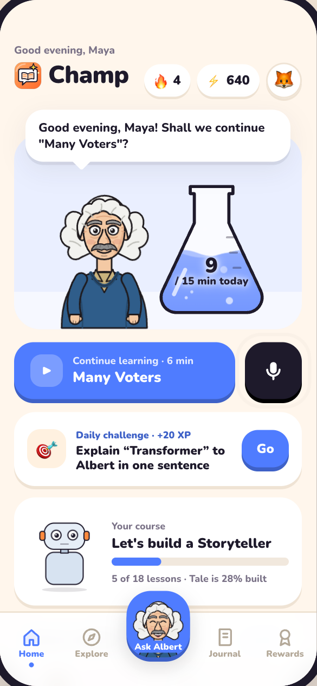
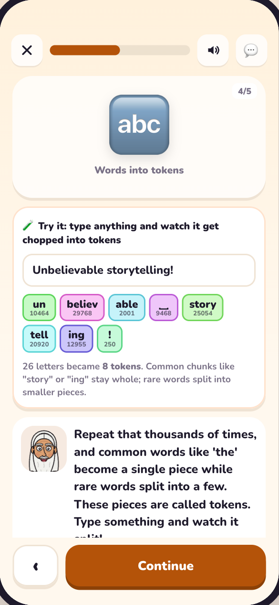
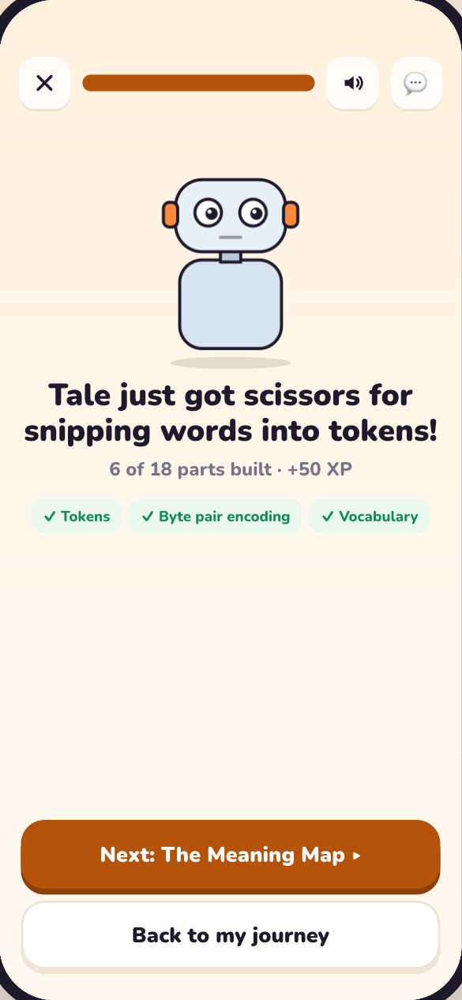
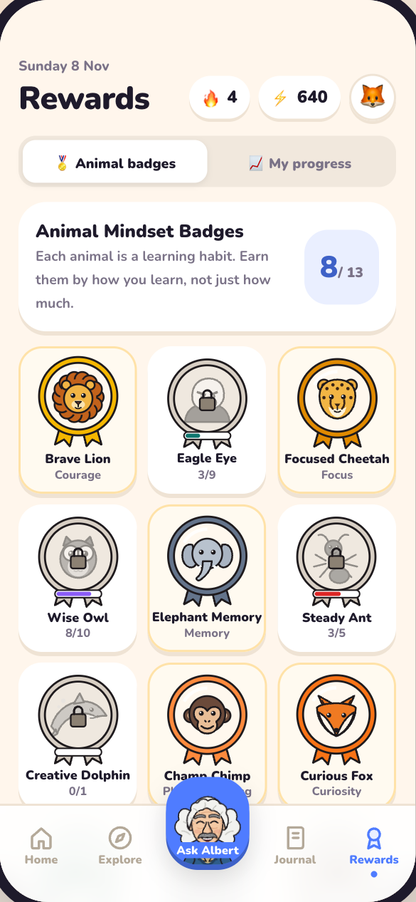

# Champ

**Learn. Think. Create. Grow.** A learning app where cartoon versions of history's greatest teachers (Einstein, Curie, Turing, da Vinci and more) teach AI through short interactive stories, out loud, and patiently answer your questions.

**▶ Live app:** https://krinavaghela.github.io/champ/ · **Code:** https://github.com/krinavaghela/champ

<p>
  
  
  
  
</p>

The live site runs without a server: teachers use practice replies and the browser's voice. Run it locally with API keys (below) for full Claude answers and ElevenLabs voices.

## Run

```bash
npm install
npm run dev        # http://localhost:5173
```

To give the teachers a real AI brain, set a Claude API key before starting (without one, they use built-in demo replies):

```bash
export ANTHROPIC_API_KEY=sk-ant-...
npm run dev
```

The easiest way to add keys: open the app, go to **Me → Voice & AI**, and paste them. They're checked and saved to `.env.local` on this computer only.

Or from the terminal: to give every teacher their own ElevenLabs voice (German-accented Einstein, French Curie, Danish Bohr, Balkan Tesla, and so on), add an ElevenLabs API key too:

```bash
export ELEVENLABS_API_KEY=...
npm run dev
```

Without it, the teachers use the browser's built-in voices. The voice for each teacher is listed in `src/lib/voices.js`; swap any `id` for another voice from the ElevenLabs Voice Library. Library voices are added to your ElevenLabs account automatically the first time a teacher speaks (each uses one custom-voice slot on your plan; if your slots run out, that teacher falls back to a built-in ElevenLabs voice). The app tries `eleven_v4`, then `eleven_v3`, then `eleven_flash_v2_5`, and uses the first one your account allows. The first two understand delivery tags such as `[curious]` or `[laughs softly]`, so teachers sound alive: questions are read with curiosity automatically, and Claude adds tags where they fit. Force a model with `ELEVENLABS_MODEL`.

Production: `npm run build && npm start`.

## The app

- **Home**: welcome from your teacher, daily challenge, continue learning, Tale's build progress, recommended lessons, streak and recent badges.
- **Explore**: the AI course *Let's build a Storyteller* (5 units, 18 story lessons based on Microsoft AI for Beginners and Karpathy's LLM101n), all the Nobel and award-winning teachers, and future subjects.
- **Story lessons**: story told out loud by a teacher → "think before you learn" prediction → hands-on experiments (perceptron, tokenizer, next-word storyteller, attention) → knowledge check with AI hints → explain it back → Tale the robot gets a new part.
- **Journal**: write, handwrite on lined paper, draw; predictions, explanations and questions are saved automatically.
- **Rewards**: Animal Mindset Badges (Lion courage, Eagle vision, Cheetah focus, Owl wisdom, Elephant memory, Ant consistency, Dolphin creativity, and more) plus *My progress*.
- **Profile** (avatar, top right): avatar, age, level, interests, teacher language, accessibility, voices & AI keys, and the parent area (grown-up check → activity chart, skills, areas needing support, screen-time limit, privacy).

## What's inside

- `src/onboarding/Onboarding.jsx`: 14 onboarding screens (splash, welcome, name, choose teacher, meet teacher, subjects, level, goal, daily goal flask, reminder wheel, placement check, plan building, plan ready, microphone). Jump to one with `?step=teacher`, `?step=minutes`, etc.
- `src/screens/Home.jsx`: home screen with tabs for Today, Laureates, Ask, Badges and Me.
- `src/screens/Legends.jsx`: Hall of Laureates. Eight fields (Physics, Chemistry, Medicine, AI & Computing, Mathematics, Economics, Literature, Peace), each with its top 5 prize winners. Tap one to hear them say hello, ask them a question, or make them your teacher.
- `src/screens/Badges.jsx` + `src/lib/badges.js`: Animal Mindset Badges. Twelve animals, each a learning habit (Curious Owl, Clever Fox, Patient Tortoise…), earned from how you learn.
- `src/screens/TutorSession.jsx`: live spoken session. Speech recognition waits for a real pause before answering; replies stream in and are spoken sentence by sentence with lip-sync.
- `src/screens/FogLesson.jsx`: "Lost in the Fog", the interactive gradient-descent story from the research brief.
- `src/lib/people.js`: every teacher: name, prize, what they're known for, personality, and how their cartoon is drawn.
- `src/components/Character.jsx`: one SVG renderer that draws every teacher from their `look` (face, hair, nose, facial hair, glasses, clothes) and animates them in code (breathing, blinking, waving, nodding, lip-sync).
- `src/components/Badge.jsx`: the animal badge medals, drawn in SVG.
- `src/lib/voices.js`: the ElevenLabs voice for each of the 40 teachers, chosen for accent, age and personality (not clones of the real people).
- `server.js`: serves the app, proxies ElevenLabs speech (`/api/tts`, so your key never reaches the browser), and streams the teacher's replies from Claude (`claude-opus-5-5`, low effort for fast replies; override with `CHAMP_MODEL`).

Open `/?gallery` to see every character side by side (add `&mood=happy` or `&size=300`).

See `UX.md` for the UX principles the app follows and where each one is applied.

Living laureates (for example the 2024 AI Nobel winners) are listed as facts but not played as characters.

Voice uses the browser's built-in speech APIs; speech recognition works best in Chrome.
